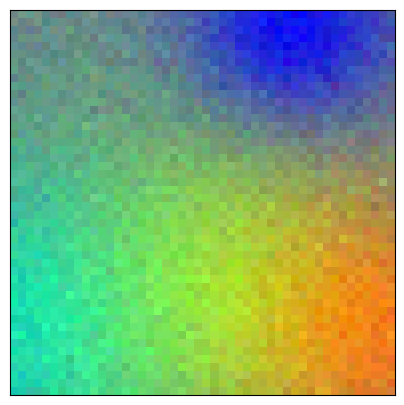
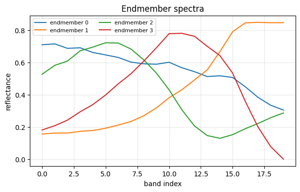
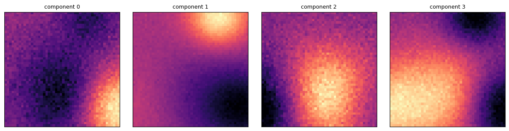

# ATLAS quickstart example

A tiny synthetic hyperspectral cube for verifying your install and running ATLAS. If these steps run, your installation is correct.

## Test Data

- `tiny_cube.npy` is a 48x48x20 cube (about 180 KiB) with genuine rank-4 structure
  (`X = A·E`): 4 smooth endmember spectra mixed by smooth abundance blobs, plus mild noise.
  Rank-4 NMF reconstructs it at about 37 dB, so there is real low-rank signal for Gaussian
  splatting to capture.
- `make_tiny_cube.py` is the deterministic generator. Rerun it to regenerate the cube with
  `python examples/make_tiny_cube.py`.

## Run it

From the repo root, with `atlas` installed (step 2 needs a CUDA GPU):

```bash
# 1. NMF initialization. CPU only. Writes endmember and abundance .npy.
atlas init --input examples/tiny_cube.npy --rank 4 --init-dir examples/init

# 2. Train (needs a CUDA GPU). The checkpoint in atlas_runs/ is the compressed cube.
atlas train --input examples/tiny_cube.npy --rank 4 \
  --num_points 500 --iterations 3000 \
  --init-dir examples/init --output-dir examples/atlas_runs

# 2b. Or the full recommended pipeline (D3, QAT, learnable endmembers, SAM):
atlas train --input examples/tiny_cube.npy --rank 4 \
  --num_points 300 --max_num_points 600 --grow_stop_iter 1000 \
  --iterations 4000 --qat_start 2000 --prune_interval 100 \
  --endmember_lr 1e-4 --sam_weight 0.05 --cholesky_bits 8 \
  --init-dir examples/init --output-dir examples/atlas_runs
```

Because the cube is rank-4, pass `--rank 4` to both commands. The default rank is for the
benchmark datasets, not this fixture.

The training summary shows `MS-SSIM: nan` for this fixture, which is expected. MS-SSIM
downsamples 4 times, so it needs images larger than 96 px on a side, and this cube is 48x48.
PSNR (about 35-37 dB) and bpppb are the meaningful numbers here.

## Inspect it (no GPU needed)

With the `[viz]` extra (`pip install "atlas-hsi[viz]"`):

```python
import atlas
from atlas import viz

cube = atlas.load_cube("examples/tiny_cube.npy")
H, W = cube.shape[:2]

viz.show_pseudo_rgb(cube, show=True)                       # RGB preview
# after running `atlas init` above:
E  = atlas.load_endmember("tiny_cube", rank=4, init_dir="examples/init")
A0 = atlas.load_abundance("tiny_cube", rank=4, init_dir="examples/init")
viz.plot_endmembers(E, show=True)                          # the 4 endmember spectra
viz.show_abundance_maps(A0, shape=(H, W), show=True)       # the 4 abundance maps
```

The three calls produce the figures below.

**Pseudo-RGB preview.** Bands 3, 10, and 16 shown as red, green, and blue, each stretched to
its own range. The colored regions are the abundance blobs seen through their spectra, and the
speckle is the fixture's added noise.



**Endmember spectra.** The 4 spectra NMF recovers, one value per band. Endmember 1 rises
toward the last bands, which is why its region at the top right shows as blue in the preview.



**Abundance maps.** How much of each endmember every pixel contains; component *i* weights
endmember *i*. Each map is a smooth blob, the low-rank spatial structure that ATLAS fits with
2D Gaussians.


